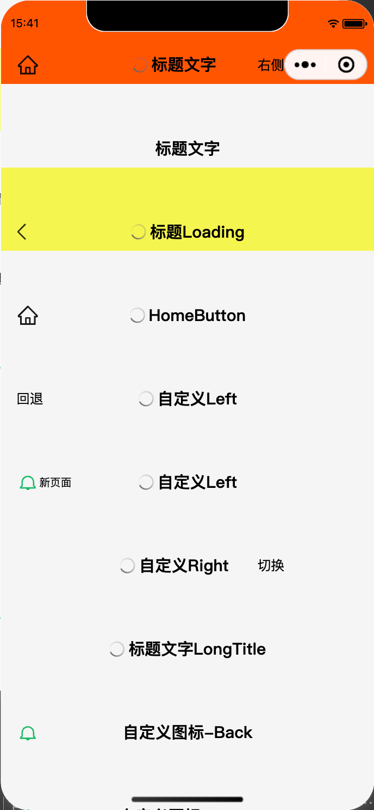
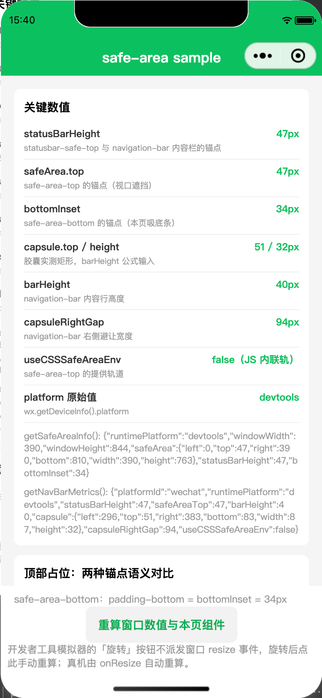

# @mini-dev/safe-area monorepo

小程序"安全区适配"能力包：把安全区 / 状态栏 / 胶囊按钮的适配数值收敛到一份逻辑库，组件库只做布局决策。当前支持微信端，支付宝 / 抖音为规划中的扩展端（接口按多端形态设计，内部已留平台分发层）。

## 包结构

| 包                                                          | 形态                                | 说明                                                                                                                                 |
| ----------------------------------------------------------- | ----------------------------------- | ------------------------------------------------------------------------------------------------------------------------------------ |
| [`@mini-dev/safe-area`](packages/safe-area/README.md)       | 逻辑库（TS + tsdown 双格式 + jest） | 安全区、状态栏、胶囊按钮数值归一，`miniprogram` 字段直供小程序构建 npm                                                               |
| [`@mini-dev/safe-area-ui`](packages/safe-area-ui/README.md) | 组件库（源码直发）                  | 五个对等组件：`safe-area-top` / `safe-area-bottom` / `statusbar-safe-top` 占位容器 + `navigation-bar` / `navigation-bar-base` 导航栏 |

## 示例工程

- `sample-safe-area-ui-wechat/` —— 四页面矩阵：safe-area 容器组件 + 逻辑库数值展示、navigation-bar 功能矩阵、navigation-bar-base 纯适配壳、autoNavIcon 自动判定分支




示例工程不属于 pnpm workspace：`cd sample-*-wechat && npm install`，微信开发者工具直接打开该目录，执行「工具 → 构建 npm」后预览。真实 appid 写在同目录的 `project.private.config.json`（已 gitignore）。

## 双轨经验（核心领域知识）

iOS 真机的顶部安全区可用 CSS `env(safe-area-inset-top)`；Android 真机与开发者工具的 `env()` 不可靠，必须用 JS 数值内联。该口径由 `@mini-dev/safe-area` 的 `getSafeAreaInfo().useCSSSafeAreaEnv` 输出，两个包与示例工程全部依赖它。

## 开发

```shell
pnpm install
pnpm lint                      # 全仓 eslint
pnpm --filter @mini-dev/safe-area build && pnpm --filter @mini-dev/safe-area test
pnpm changeset                 # 变更集；发布走 pnpm release（changesets publish）
```

工程与协作约定见 [AGENTS.md](AGENTS.md)。

## 许可证

MIT
