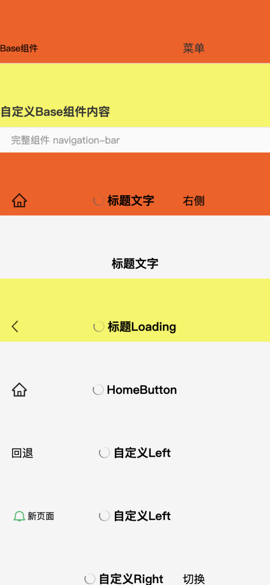

# @mini-dev/safe-area-ui

小程序安全区与导航栏组件库（源码直发，无构建），五个对等组件：

- `safe-area-top` / `safe-area-bottom` —— 顶部 / 底部安全区占位容器（视口遮挡语义），把安全区占位/内边距适配封装成即用标签；
- `statusbar-safe-top` —— 状态栏锚点占位容器，内边距 = `statusBarHeight`（状态栏下缘，与胶囊定位基准同源）；
- `navigation-bar` —— 功能完善的微信小程序自定义导航栏组件（自定义标题、返回/首页按钮、loading、自动导航、weui 视觉、多 slot），修正官方 Demo 中 navigation-bar 的问题；
- `navigation-bar-base` —— 纯适配壳，只处理胶囊按钮占位、安全区、iOS/Android 高度差异，不含内置样式与行为。

适配数据统一来自 [@mini-dev/safe-area](../safe-area/README.md) 逻辑库（iOS 走 CSS `env()` / Android 与开发者工具走 JS 数值的双轨经验保持不变）。

## 1. 安装

```shell
npm install @mini-dev/safe-area-ui
```

组件依赖 `@mini-dev/safe-area`，npm 会一并安装。安装后需要在微信开发者工具中执行一次「工具 → 构建 npm」（会同时构建两个包）。

## 2. 快速上手

### 2.1 构建 npm

构建 npm 会把 `miniprogram: "libs"` 指向的源码目录平铺到 `miniprogram_npm/@mini-dev/safe-area-ui/`，同时把依赖包 `@mini-dev/safe-area` 一并构建。

### 2.2 声明组件

```json
{
    "usingComponents": {
        "safe-area-top": "@mini-dev/safe-area-ui/safe-area-top",
        "safe-area-bottom": "@mini-dev/safe-area-ui/safe-area-bottom",
        "statusbar-safe-top": "@mini-dev/safe-area-ui/statusbar-safe-top",
        "navigation-bar": "@mini-dev/safe-area-ui/navigation-bar",
        "nav-bar-base": "@mini-dev/safe-area-ui/navigation-bar-base"
    }
}
```

### 2.3 基础用法

```xml
<safe-area-top ext-class="my-top">
    <view class="nav-title">标题</view>
</safe-area-top>

<view>页面内容</view>

<safe-area-bottom ext-class="my-bottom">
    <button>吸底操作按钮</button>
</safe-area-bottom>
```

```xml
<navigation-bar title="页面标题" back="{{false}}" color="black" background="#FFF" />
```

## 3. API 参考

### 3.1 safe-area-top

渲染一个顶部安全区占位容器，内边距为顶部安全区高度（`safeAreaTop` = `safeArea.top`，视口遮挡语义）。

| 属性名   | 类型   | 默认值 | 说明                         |
| -------- | ------ | ------ | ---------------------------- |
| extClass | String | ''     | 自定义类名，追加到容器根节点 |

| 插槽     | 说明                                                     |
| -------- | -------------------------------------------------------- |
| 默认插槽 | 顶部区域内容（如自定义导航标题），渲染在安全区内边距之内 |

### 3.2 safe-area-bottom

渲染一个底部安全区占位容器，内边距为 `windowHeight - safeArea.bottom`。

| 属性名   | 类型   | 默认值 | 说明                         |
| -------- | ------ | ------ | ---------------------------- |
| extClass | String | ''     | 自定义类名，追加到容器根节点 |

| 插槽     | 说明                                               |
| -------- | -------------------------------------------------- |
| 默认插槽 | 底部区域内容（如吸底按钮），渲染在安全区内边距之内 |

### 3.3 statusbar-safe-top

渲染一个状态栏锚点占位容器，内边距为 `statusBarHeight`（状态栏下缘，与胶囊定位基准同源）。适用于「内容从状态栏之下开始」的占位场景。

| 属性名   | 类型   | 默认值 | 说明                         |
| -------- | ------ | ------ | ---------------------------- |
| extClass | String | ''     | 自定义类名，追加到容器根节点 |

| 插槽     | 说明                                             |
| -------- | ------------------------------------------------ |
| 默认插槽 | 状态栏之下的区域内容，渲染在状态栏高度内边距之内 |

与 `safe-area-top` 的区别在锚点语义：`safe-area-top` 取 `safeArea.top`（视口遮挡语义，iOS 真机由 `env()` 提供）；`statusbar-safe-top` 取 `statusBarHeight`（状态栏锚点，`statusBarHeight` 无 CSS 等价物，恒由 JS 内联提供）。真机实测两者可能不一致的机型上，两个组件渲染出不同的顶部内边距，按页面语义选用。

`safe-area-top` / `safe-area-bottom` / `statusbar-safe-top` 处于样式隔离（`styleIsolation: 'isolated'`）下，页面样式只能通过外部样式类进入组件：`ext-class` / `mini-class` / `ui-class` 均为外部样式类，传入的类名在页面作用域解析后套用到组件根节点（`{{...}}` 类名插值在隔离模式下不生效，不要用）。

### 3.4 navigation-bar



支持自定义标题、背景色、文字颜色，返回按钮和首页按钮的显示控制，自动图标判定（`autoNavIcon`，根据页面深度自动决定返回/首页按钮；首页按钮点击仅触发事件，跳转由页面实现），加载状态，动画效果，多 slot 自定义（左侧、中间、右侧），并适配 iOS 和 Android 系统差异。

| 属性名      | 类型    | 默认值 | 说明                                                                                                                    |
| ----------- | ------- | ------ | ----------------------------------------------------------------------------------------------------------------------- |
| extClass    | String  | ''     | 自定义类名                                                                                                              |
| title       | String  | ''     | 导航栏标题                                                                                                              |
| background  | String  | ''     | 导航栏背景色                                                                                                            |
| color       | String  | ''     | 导航栏文字颜色                                                                                                          |
| back        | Boolean | true   | 是否显示返回按钮                                                                                                        |
| homeButton  | Boolean | false  | 是否显示首页按钮                                                                                                        |
| loading     | Boolean | false  | 是否显示加载状态                                                                                                        |
| animated    | Boolean | true   | 显示/隐藏时是否启用动画效果                                                                                             |
| show        | Boolean | true   | 是否显示导航栏（隐藏时仍保留高度占位）                                                                                  |
| delta       | Number  | 1      | 返回按钮的返回页面深度                                                                                                  |
| autoNavIcon | Boolean | false  | 是否自动判定返回/首页图标：attached 时按页面栈深度决定（栈深 1 → 首页按钮，否则返回按钮），开启时覆盖 back / homeButton |
| backIcon    | String  | ''     | 自定义返回按钮图标地址（缺省用内置 weui 图标）                                                                          |
| homeIcon    | String  | ''     | 自定义首页按钮图标地址（缺省用内置 weui 图标）                                                                          |

| 事件名 | 说明                                                         | 回调参数                |
| ------ | ------------------------------------------------------------ | ----------------------- |
| back   | 点击返回按钮时触发                                           | { delta: 返回页面深度 } |
| home   | 点击首页按钮时触发（纯通知语义，跳转由页面在事件处理中实现） | {}                      |

| 插槽名 | 说明                                                            |
| ------ | --------------------------------------------------------------- |
| left   | 左侧区域自定义内容（仅在 back 和 homeButton 都为 false 时显示） |
| center | 中间区域自定义内容（仅在 title 为空时显示）                     |
| right  | 右侧区域自定义内容                                              |

### 3.5 navigation-bar-base

如果项目要完全自定义导航栏的样式与内容，只需要组件处理**胶囊按钮占位、安全区、iOS/Android 高度差异**这些适配逻辑，可以使用 `navigation-bar-base`。它不内置任何视觉样式，也不含返回/首页/loading 等行为，只提供一个布局壳和一个默认 slot。

```xml
<nav-bar-base ext-class="custom-nav">
    <view style="display:flex;justify-content:space-between;width:100%;">
        <text bind:tap="onBack">返回</text>
        <text>标题</text>
        <text bind:tap="onMenu">菜单</text>
    </view>
</nav-bar-base>
```

| 属性名   | 类型   | 默认值 | 说明                                     |
| -------- | ------ | ------ | ---------------------------------------- |
| extClass | String | ''     | 自定义类名，用于覆盖背景色、文字色等样式 |

`navigation-bar` 与 `navigation-bar-base` 如何选择：

- 只需要适配、想完全自管样式与内容 → 用 `@mini-dev/safe-area-ui/navigation-bar-base`。
- 需要内置的返回/首页按钮、loading、自动导航、weui 视觉、多 slot → 用 `@mini-dev/safe-area-ui/navigation-bar`。

### 3.6 顶部内边距的取值说明

- **safe-area-top**：以 `safeAreaTop` 为锚（视口遮挡语义，取自 `getSafeAreaInfo()`）。提供轨道由 `getSafeAreaInfo().useCSSSafeAreaEnv` 驱动：iOS 真机走 CSS `env(safe-area-inset-top, 0px)`（与 `safeArea.top` 同源相等，实测维持的唯一非构造性假设）；Android 真机 / 开发者工具 / HarmonyOS NEXT / 未识别平台（unknown）的 `env()` 不可靠或不可假设，改用 JS 数值内联；windows / mac 桌面端未经验证但无顶部 inset，维持 CSS 轨。JS 轨上 wxss 的 `env()` 仅承担首帧近似与 JS 失效兜底。
- **safe-area-bottom**：以 `bottomInset` 为锚，不消费双轨判定——`padding-bottom` 恒由 JS 内联提供；wxss 的 `env(safe-area-inset-bottom)` 仅承担首帧近似与 JS 失效兜底。
- **statusbar-safe-top**：以 `statusBarHeight` 为锚（状态栏下缘），不消费双轨判定——`statusBarHeight` 没有 CSS 等价物，`padding-top` 恒由 JS 内联提供；wxss 中的 `env(safe-area-inset-top)` 仅承担 setData 生效前首帧的近似与 JS 失效兜底。
- **navigation-bar / navigation-bar-base**：不消费双轨判定。内容栏顶部内边距在两条轨道上均由 JS 内联 `statusBarHeight` 提供，与 `barHeight` 推导锚点同源（胶囊由客户端参照状态栏定位，真机实测 `statusBarHeight` 与 `safeArea.top` 可能不一致），胶囊居中由构造成立；wxss 中的 `env(safe-area-inset-top)` 仅承担 setData 生效前首帧的近似与 JS 失效兜底。导航内容行高度 `barHeight = (capsule.top − statusBarHeight) × 2 + capsule.height`，胶囊不可用时回退 Android 48px、其余 44px；右侧胶囊按钮通过 `capsuleRightGap` 做内边距避让。

数值的完整公式定义见 `@mini-dev/safe-area` README 的 §2.5（定义域、约束系统、派生数值表、渲染映射与层边界假设）。

五个组件都在 `attached` 注册 `wx.onWindowResize`（`detached` 注销），并叠加 `pageLifetimes.resize` 双通道：窗口尺寸变化（如 `pageOrientation: "auto"` 下的横竖屏旋转）时由 `_updateLayout()` 重算 JS 内联取值与胶囊避让。iOS 轨的 `env()` 由渲染引擎随布局自动重算，双轨在旋转后均保持正确。注意：开发者工具模拟器的「旋转」按钮不派发窗口 resize 事件（实测已知差异），旋转链路以真机预览为准；示例工程首页提供手动重算入口，便于在模拟器核对取数。

## 4. 使用示例

### 4.1 自定义导航占位

```xml
<safe-area-top>
    <view class="nav-inner">页面标题</view>
</safe-area-top>
```

### 4.2 吸底操作区

```xml
<safe-area-bottom>
    <button bind:tap="onSubmit">提交</button>
</safe-area-bottom>
```

### 4.3 状态栏锚点占位

```xml
<statusbar-safe-top>
    <view class="statusbar-inner">状态栏之下的内容</view>
</statusbar-safe-top>
```

### 4.4 完整导航栏示例

```xml
<navigation-bar
    title="首页"
    back="{{false}}"
    homeButton="{{true}}"
    color="#333333"
    background="#FFFFFF"
    loading="{{false}}"
    animated="{{true}}"
    show="{{true}}"
    delta="1"
    autoNavIcon="{{false}}"
    extClass="custom-nav"
    bind:back="onBack"
    bind:home="onHome"
>
    <view slot="left">
        <text>自定义左侧</text>
    </view>

    <view slot="center">
        <text style="color: red;">自定义标题</text>
    </view>

    <view slot="right">
        <text>右侧按钮</text>
    </view>
</navigation-bar>
```

## 5. 平台示例工程

见 `sample-safe-area-ui-wechat/`：`file:` 依赖本地包，微信开发者工具直接打开该目录，构建 npm 后预览。页面矩阵：

- `pages/index/` —— `safe-area-top` / `safe-area-bottom` / `statusbar-safe-top` 示例（两种顶部锚点语义对照演示、吸底操作区）+ 关键数值表与 `getSafeAreaInfo()` / `getNavBarMetrics()` 实机返回值，并提供其余示例页入口；
- `pages/nav-bar/` —— `navigation-bar` 组件功能矩阵；
- `pages/nav-bar-base/` —— `navigation-bar-base` 纯适配壳示例；
- `pages/not-home/` —— `autoNavIcon` 自动判定分支。

真实 appid 写在同目录的 `project.private.config.json`（已被 git 忽略）。`app.json` 开启了 `"pageOrientation": "auto"`，可配合模拟器「旋转」按钮实测横屏安全区（`safeArea.left` / `safeArea.right`）取值。

## 6. 项目结构

```
safe-area-ui/                      # monorepo 内的包目录
├── libs/                          # 组件实现目录（构建 npm 时平铺到包根）
│   ├── _Component.js              # 共享基座（safe-area-top / safe-area-bottom 使用）
│   ├── index.js                   # 包 JS 入口，只导出共享基座
│   ├── index.d.ts                 # 组件类型声明
│   ├── safe-area-top/             # 顶部安全区容器组件
│   ├── safe-area-bottom/          # 底部安全区容器组件
│   ├── statusbar-safe-top/         # 状态栏锚点占位容器组件
│   ├── navigation-bar/            # 完整导航栏组件
│   └── navigation-bar-base/       # 基础适配壳组件
└── screenshots/                   # 示例截图
```

## 7. 作为模板使用

本包是 `@mini-dev` 源码直发组件库模板（平铺 `libs/` + 共享基座 `_Component`）的多组件实例：对等组件平铺在 `libs/<name>/` 子目录，包入口 `libs/index.js` 只导出共享基座。其中 `navigation-bar` / `navigation-bar-base` 为本包全新组件（0.0.1 首发，与任何独立时期的旧项目无关联），保持独立的 `Component()` 定义，未套 `_Component` 基座。以此新建组件库时参考 monorepo 根 README 与各模板文档。

## 8. 开发与工具链

| 命令                                             | 说明                        |
| ------------------------------------------------ | --------------------------- |
| `pnpm --filter @mini-dev/safe-area-ui lint`      | eslint 校验 `libs/`         |
| `pnpm --filter @mini-dev/safe-area-ui typecheck` | `tsc --noEmit` 校验 `.d.ts` |
| `pnpm changeset`                                 | 生成变更集                  |

本地联调：`cd sample-safe-area-ui-wechat && npm install`，微信开发者工具打开该目录，构建 npm 后预览；改动 `libs/` 后重新构建 npm 即可生效。

提交走约定式提交（commitlint），版本与 CHANGELOG 由 changesets 生成，不手写。

## 9. 版本

`navigation-bar` / `navigation-bar-base` 为本包全新组件，随 `@mini-dev/safe-area-ui` 0.0.1 首发，与任何独立时期的旧项目无版本延续关系；后续版本与 CHANGELOG 由 changesets 生成。

## 10. 许可证

MIT License
