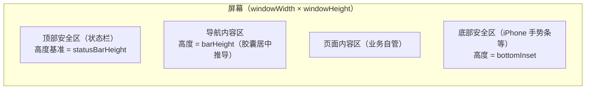
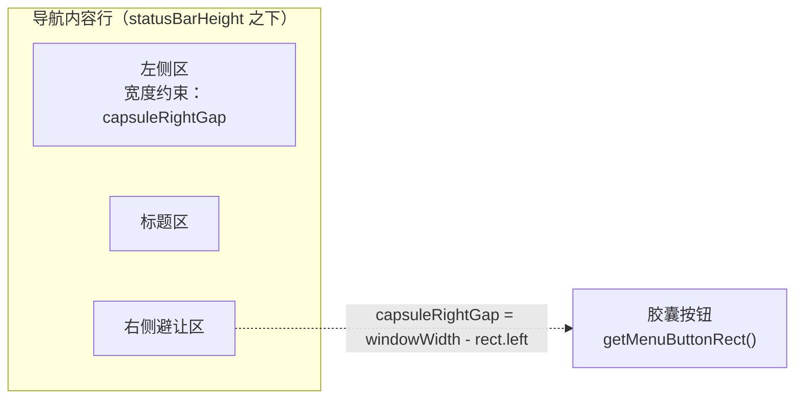
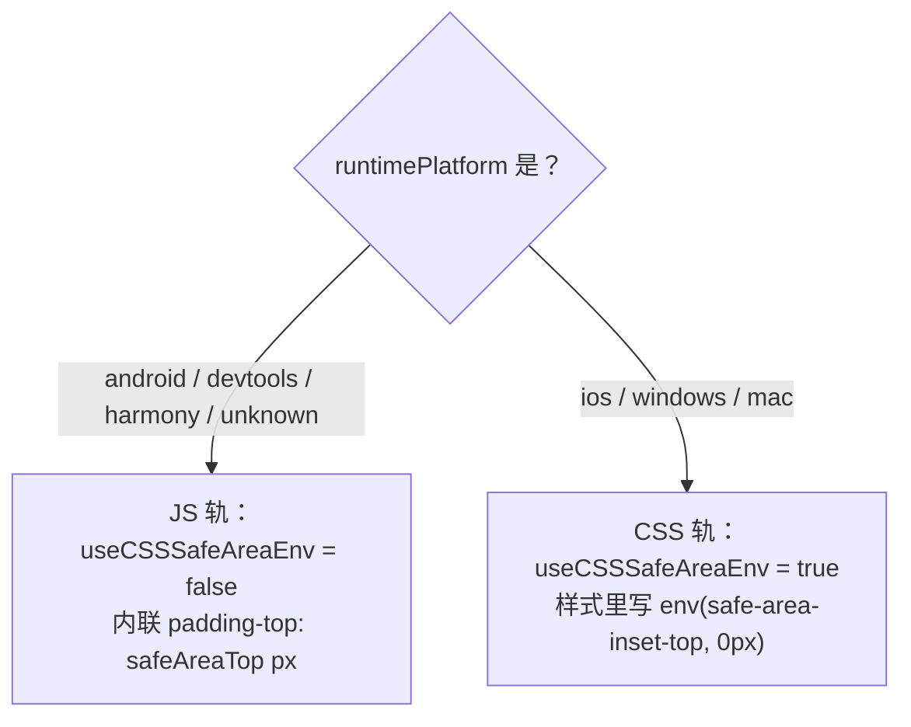
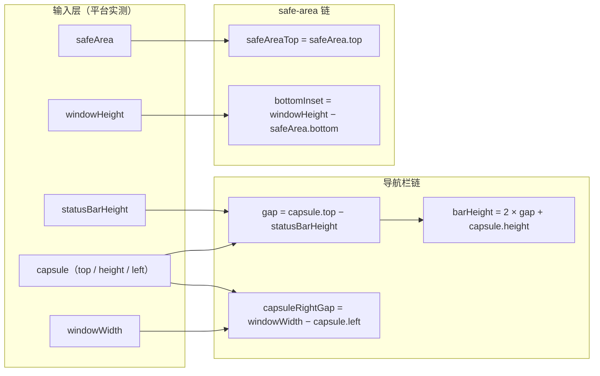
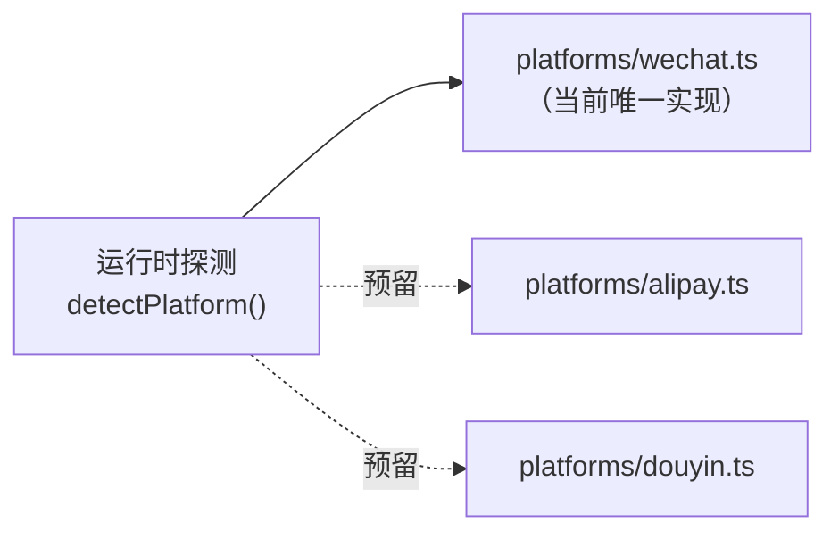

# @mini-dev/safe-area

小程序安全区适配逻辑库：把**安全区、状态栏、胶囊按钮**的适配数值收敛为一份跨端一致的 API。当前实现微信端，支付宝 / 抖音为规划中的扩展端（接口按多端形态设计，内部已留平台分发层）。

本库只产出**数值**，不产出样式字符串——布局决策（`padding`、`calc`）由消费方组件负责，因此它能同时服务导航栏、吸底操作区、全屏容器等场景。

## 1. 安装

```shell
npm install @mini-dev/safe-area
```

安装后需要在开发者工具中执行一次「工具 → 构建 npm」：[微信 npm 支持说明](https://developers.weixin.qq.com/miniprogram/dev/devtools/npm.html)。

## 2. 尺寸概念图解

### 2.1 屏幕纵向分区



- **顶部安全区**：状态栏所在区域。自定义导航栏（`navigationStyle: custom`）场景下，内容必须从这条线之下开始。高度有两个口径：`statusBarHeight`（状态栏高度，胶囊与导航内容行的定位基准）与 `safeArea.top`（安全区上缘）——两者是不同取值路径的独立字段，真机实测可能不一致（见 2.2）。
- **导航内容区**：导航栏标题、按钮所在的内容行，高度由胶囊矩形推导（`barHeight`，见 2.2），确保胶囊在内容行内垂直居中；胶囊不可用时回退平台基准（iOS / 工具 44，Android 48）。
- **底部安全区**：全面屏底部手势条所在区域。吸底按钮、`fixed` 底栏必须留出这段距离。
- `safeAreaTop`、`bottomInset` 合起来即"四边安全区"中的上下两边；`safeArea` 矩形字段（`left` / `right`）覆盖左右横屏场景。

### 2.2 导航行与胶囊避让



`capsuleRightGap` 是胶囊按钮左侧到屏幕右缘的整段宽度，导航栏两种用法共用同一数值：

- 作为内容行右侧的 `padding-right`，保证标题居中计算不被胶囊遮挡；
- 作为左侧区的 `min-width`，保证左右两侧对称（见 `@mini-dev/safe-area-ui` 的 `navigation-bar` 既有布局口径）。

纵向维度的内容行高度由胶囊矩形推导，锚点取 `statusBarHeight` 而非 `safeArea.top`：胶囊由客户端参照状态栏定位（真机实测依据），且 iOS 真机实测两者可能不一致，无恒等保证。完整约束系统、公式、回退与渲染映射见 2.5。

### 2.3 尺寸字段速查

示例取自典型机型：iPhone（`windowWidth` 390）与 Android（`windowWidth` 393）。

| 字段                               | 含义                                                                                                  | iPhone 示例 | Android 示例 |
| ---------------------------------- | ----------------------------------------------------------------------------------------------------- | ----------- | ------------ |
| `windowWidth` / `windowHeight`     | 可用窗口宽高（逻辑像素）                                                                              | 390 / 844   | 393 / 851    |
| `statusBarHeight`                  | 状态栏高度（官方字段口径）                                                                            | 47          | 35           |
| `safeArea.top`                     | 安全区上缘（顶部安全区高度）                                                                          | 47          | 35           |
| `safeArea.bottom`                  | 安全区下缘（距窗口顶部的距离）                                                                        | 810         | 818          |
| `safeAreaTop`                      | 顶部安全区高度（= `safeArea.top`；`getSafeAreaInfo()` 顶层字段，safe-area-top/bottom 的 JS 内联取值） | 47          | 35           |
| `bottomInset`                      | 底部安全区高度（= `windowHeight - safeArea.bottom`）                                                  | 34          | 33           |
| `barHeight`                        | 导航内容行高度（以 `statusBarHeight` 为锚推导；回退 44 / 48）                                         | 44          | 50           |
| `capsule.width` / `capsule.height` | 胶囊按钮尺寸                                                                                          | 87 / 32     | 87 / 32      |
| `capsuleRightGap`                  | 胶囊避让宽度（= `windowWidth - capsule.left`）                                                        | 109         | 112          |
| `useCSSSafeAreaEnv`                | 顶部能否走 CSS `env()` 轨（`getSafeAreaInfo()` 字段，见 2.4）                                         | `true`      | `false`      |

### 2.4 顶部双轨判定

`env(safe-area-inset-top)` 在 iOS 真机可靠，但 **Android 真机与开发者工具不可靠**；HarmonyOS NEXT 与未识别平台（`unknown`）的 `env()` 行为不可假设，与前者一并保守走 JS 轨（`padding-top: safeAreaTop px`）。`windows` / `mac` 桌面客户端的 `env()` 支持同样未经验证，但桌面端没有顶部 inset、两轨数值一致为 0，维持 CSS 轨。判定字段是 `getSafeAreaInfo().useCSSSafeAreaEnv`：



`unknown` 走 JS 轨是危害不对称下的保守方向：JS 轨的最坏情况与 CSS 轨的最佳情况等价（`safeAreaTop` 与 `env()` 同语义），CSS 轨的最坏情况是 `env()` 失效导致顶部占位塌陷；未识别平台没有可依赖的实测依据，方向取保守侧。取值轨道按组件的消费方式分：

- **safe-area-top**：唯一由该字段驱动轨道的组件，消费方不应自行判定平台。CSS 轨（iOS 真机）以 `env(safe-area-inset-top, 0px)` 为值提供者——`env()` 与 `safeArea.top` 同源相等是实测维持的事实，也是本库公式体系唯一的非构造性假设（真机回归需覆盖）；JS 轨（Android / devtools / HarmonyOS / unknown）由 JS 内联 `safeAreaTop` 提供同语义数值，wxss 中的 `env(safe-area-inset-top, 0px)` 在此仅承担 setData 生效前首帧的近似与 JS 失效时的兜底（环境变量缺失时取 0）。
- **safe-area-bottom**：不消费该判定，`padding-bottom` 恒由 JS 内联 `bottomInset` 提供（对双轨判定取保守超集）；wxss 中的 `env(safe-area-inset-bottom)` 仅承担 setData 生效前首帧的近似与 JS 失效时的兜底。
- **navigation-bar / navigation-bar-base**：不消费该判定。内容栏顶部内边距在两条轨道上均由 JS 内联 `statusBarHeight` 提供，与 `barHeight` 推导锚点同源，胶囊居中由构造成立；其 wxss 中的 `env(safe-area-inset-top)` 仅承担 setData 生效前首帧的近似与 JS 失效时的兜底，不参与数值定义。
- **statusbar-safe-top**：不消费该判定。`padding-top` 恒由 JS 内联 `statusBarHeight` 提供（状态栏锚点语义，`statusBarHeight` 无 CSS 等价物）；其 wxss 中的 `env(safe-area-inset-top)` 仅承担 setData 生效前首帧的近似与 JS 失效时的兜底。

### 2.5 计算公式（公式层）

数值定义的权威表述。所有数值均为逻辑像素、同一视口坐标系。



#### 2.5.1 定义域与有效性

- 页面为 `navigationStyle: "custom"`：视口顶 = 屏幕顶，`statusBarHeight`、`capsule`、`safeArea` 同属视口坐标系；
- **胶囊有效** ⟺ `capsule ≠ null` 且 `gap ≥ 0` 且 `capsule.height > 0` 且坐标均为有限数值；反之为**胶囊无效**（`capsule = null` ∨ `gap < 0` ∨ `capsule.height ≤ 0` ∨ 坐标含非有限数值），派生值按 2.5.3 回退。

#### 2.5.2 约束系统与求解

内容行几何由两条约束唯一确定：

```text
C1（锚定）：内容栏顶 = 状态栏下缘
    rowTop = statusBarHeight

C2（居中）：胶囊中心 = 内容栏中心
    capsule.top + capsule.height / 2 = rowTop + barHeight / 2

代入 C1 求解：
    gap       = capsule.top − statusBarHeight
    barHeight = 2 × gap + capsule.height
```

居中由构造成立：

```text
rowTop + barHeight / 2
  = statusBarHeight + (capsule.top − statusBarHeight) + capsule.height / 2
  = capsule.top + capsule.height / 2        （= 胶囊中心）
```

#### 2.5.3 派生数值表

| 数值                | 公式                                                         | 说明                                            |
| ------------------- | ------------------------------------------------------------ | ----------------------------------------------- |
| `gap`               | `capsule.top − statusBarHeight`                              | 中间量，不进 API                                |
| `barHeight`         | `2 × gap + capsule.height`；胶囊无效时取 `android ? 48 : 44` | 导航内容行高度                                  |
| `navHeight`         | `statusBarHeight + barHeight`                                | 导航栏总高，由两个已暴露值合成，不单独设字段    |
| `capsuleRightGap`   | `windowWidth − capsule.left`；胶囊无效时取 `0`               | 胶囊避让宽度                                    |
| `safeAreaTop`       | `safeArea.top`                                               | `SafeAreaInfo` 顶层字段；safe-area 链顶部锚     |
| `bottomInset`       | `windowHeight − safeArea.bottom`                             | `SafeAreaInfo` 顶层字段；safe-area 链底部锚     |
| `useCSSSafeAreaEnv` | `runtimePlatform ∈ { ios, windows, mac }`                    | `SafeAreaInfo` 字段；safe-area 链的提供轨道选择 |

#### 2.5.4 渲染映射

| 组件                                 | 渲染量                             | 公式                                                     |
| ------------------------------------ | ---------------------------------- | -------------------------------------------------------- |
| navigation-bar / navigation-bar-base | `padding-top`                      | `statusBarHeight`（两条轨道均由 JS 内联）                |
| navigation-bar / navigation-bar-base | `--height`                         | `barHeight`                                              |
| navigation-bar / navigation-bar-base | `height`                           | `calc(var(--height) + statusBarHeight)`（= `navHeight`） |
| navigation-bar / navigation-bar-base | `padding-right` / 左区 `min-width` | `capsuleRightGap`                                        |
| safe-area-top                        | `padding-top`                      | `safeAreaTop`                                            |
| statusbar-safe-top                   | `padding-top`                      | `statusBarHeight`（恒由 JS 内联）                        |
| safe-area-bottom                     | `padding-bottom`                   | `bottomInset`                                            |

#### 2.5.5 层边界与假设

- 导航栏链只消费 `statusBarHeight`、`capsule`、`windowWidth`；safe-area 链只消费 `safeArea`、`windowHeight`。两链无共享派生值，API 面按链对齐：`getSafeAreaInfo()` 承载 safe-area 链（`safeAreaTop` / `bottomInset` / `useCSSSafeAreaEnv`），`getNavBarMetrics()` 只承载导航栏链（`statusBarHeight` / `barHeight` / `capsule` / `capsuleRightGap`）；两链数值语义分别是「内容行起点」与「视口遮挡」，实测设备上可以不相等；
- `env(safe-area-inset-*)` 的身份按链拆分：导航栏链中仅为 setData 生效前首帧的近似与 JS 失效兜底，不参与数值定义；safe-area 链 CSS 轨中是值提供者，`env() ≡ safeArea.top` 依赖同源实测（目前仅 iOS 真机验证；windows / mac 同轨未实测，但桌面无顶部 inset，两轨一致为 0），是本体系**唯一的非构造性假设**，真机回归需覆盖；
- wxss 静态 `--height`（44 / 48）仅作导航栏链的兜底，不承担定义；
- **居中保证的成立范围**：`capsule.top ≥ statusBarHeight`（实际语义 = 竖屏布局）。域外 C2 显式放弃、C1 保留、`barHeight` 取平台常量——形式自洽，但居中不保证。

## 3. API 使用说明

### 3.1 导入方式

发布产物同时支持 CommonJS 与 ES Module，按项目习惯任选：

```ts
import { getSafeAreaInfo, getNavBarMetrics } from '@mini-dev/safe-area';
// 或 CommonJS：
// const { getSafeAreaInfo, getNavBarMetrics } = require('@mini-dev/safe-area');
// 或默认导出：
// import safeArea from '@mini-dev/safe-area';
```

类型（`SafeAreaInfo` / `NavBarMetrics` / `Rect` / `PlatformId` / `RuntimePlatform`）同样可从包内导入；`RawSafeAreaData` 是平台适配层的内部契约，不对外导出。

### 3.2 getPlatformId()

```ts
function getPlatformId(): PlatformId; // 'wechat' | 'alipay' | 'douyin' | 'unknown'
```

返回当前探测到的运行端标识。当前仅 `'wechat'`（探测全局 `wx`）与 `'unknown'`（未探测到任何已支持端）两种结果；支付宝 / 抖音接入后各自返回 `'alipay'` / `'douyin'`。

### 3.3 getSafeAreaInfo()

```ts
function getSafeAreaInfo(): SafeAreaInfo;
```

返回窗口与四边安全区的完整数值（示例为 iPhone）：

```json
{
    "runtimePlatform": "ios",
    "windowWidth": 390,
    "windowHeight": 844,
    "safeArea": { "left": 0, "top": 47, "right": 390, "bottom": 810, "width": 390, "height": 763 },
    "statusBarHeight": 47,
    "safeAreaTop": 47,
    "bottomInset": 34,
    "useCSSSafeAreaEnv": true
}
```

| 字段                           | 类型              | 说明                                                                                           |
| ------------------------------ | ----------------- | ---------------------------------------------------------------------------------------------- |
| `runtimePlatform`              | `RuntimePlatform` | `ios` / `android` / `harmony` / `devtools` / `windows` / `mac` / `unknown`                     |
| `windowWidth` / `windowHeight` | `number`          | 可用窗口宽高                                                                                   |
| `safeArea`                     | `Rect`            | 系统安全区矩形，坐标相对窗口左上角                                                             |
| `statusBarHeight`              | `number`          | 状态栏高度                                                                                     |
| `safeAreaTop`                  | `number`          | 顶部安全区高度（= `safeArea.top`），与 `bottomInset` 对称；与 `statusBarHeight` 实测可能不一致 |
| `bottomInset`                  | `number`          | 底部安全区高度，由 `windowHeight - safeArea.bottom` 派生                                       |
| `useCSSSafeAreaEnv`            | `boolean`         | 顶部双轨判定，见 2.4；safe-area 链消费方不应自行判定平台                                       |

### 3.4 getMenuButtonRect()

```ts
function getMenuButtonRect(): Rect | null;
```

返回右上角胶囊按钮矩形（`left` / `top` / `right` / `bottom` / `width` / `height`，逻辑像素）。以下情况返回 `null`：

- 当前端没有对应 API；
- API 返回零值或含非有限数值（例如 PC 端返回全 0 矩形）。

返回 `null` 时消费方应按"无胶囊可避让"处理（如 `@mini-dev/safe-area-ui` 的 `navigation-bar` 将 `capsuleRightGap` 归零）。

### 3.5 getNavBarMetrics()

```ts
function getNavBarMetrics(): NavBarMetrics;
```

导航栏场景的一站式派生值，内部经平台适配器读取原始窗口数据（与 `getSafeAreaInfo()` 同源）与 `getMenuButtonRect()` 的胶囊矩形，只承载导航栏链数值；safe-area 链字段（`safeAreaTop` / `useCSSSafeAreaEnv`）见 3.3（示例为 Android）：

```json
{
    "platformId": "wechat",
    "runtimePlatform": "android",
    "statusBarHeight": 35,
    "barHeight": 50,
    "capsule": { "left": 281, "top": 44, "right": 368, "bottom": 76, "width": 87, "height": 32 },
    "capsuleRightGap": 112
}
```

| 字段              | 类型              | 说明                                                                                                                                                    |
| ----------------- | ----------------- | ------------------------------------------------------------------------------------------------------------------------------------------------------- |
| `platformId`      | `PlatformId`      | 当前端标识                                                                                                                                              |
| `runtimePlatform` | `RuntimePlatform` | 系统 / 工具维度平台，需要平台分支的消费方以此字段判定                                                                                                   |
| `statusBarHeight` | `number`          | 状态栏高度；胶囊与导航内容行的定位 / 推导基准                                                                                                           |
| `barHeight`       | `number`          | 导航内容行高度 = `(capsule.top − statusBarHeight) × 2 + capsule.height`（锚点与胶囊定位基准一致，胶囊垂直居中）；胶囊不可用时回退 `android` 48、其余 44 |
| `capsule`         | `Rect \| null`    | 胶囊按钮矩形，语义同 3.4                                                                                                                                |
| `capsuleRightGap` | `number`          | 胶囊避让宽度 = `windowWidth - capsule.left`；胶囊不可用时为 0                                                                                           |

### 3.6 错误与降级行为

- **无已支持运行时**：任何取数函数抛出 `[safe-area] no supported mini-program runtime detected: expected wx (wechat)`，消息由已注册适配器列表动态生成（加端后自动列出全部端）。
- **基础库版本降级**：微信实现优先 `wx.getWindowInfo()` + `wx.getDeviceInfo()`（基础库 2.20+），两者任一缺失时自动改用 `wx.getSystemInfoSync()`；都没有时抛出带上下文的错误。
- **原始数据归一化（逻辑库内统一防御，消费方无需重复兜底）**：
    - `windowWidth` / `windowHeight` 非有限 → 抛 `[safe-area] invalid window dimensions: ...`（运行时已损坏，无从降级）；
    - `safeArea` 为 `null`、含非有限数值或零尺寸（低版本基础库有 null 反馈）→ 合成回退矩形 `{ left: 0, top: statusBarHeight, right: windowWidth, bottom: windowHeight }`：顶部以 `statusBarHeight` 近似（绝大多数机型两者相等），底部按无遮挡处理（`bottomInset = 0`）；
    - `statusBarHeight` 非有限 → 归零（按无状态栏处理）。

### 3.7 旋转与窗口变化

逻辑库无状态、每次调用现读取值：窗口旋转后再次调用 `getSafeAreaInfo()` / `getNavBarMetrics()` 即返回当前方向的数值（横屏下 `safeArea.left` / `safeArea.right` 开始承担 notch 避让）。但取数方需要自己感知旋转——订阅 `wx.onWindowResize` 或页面 `onResize` 后重取；`@mini-dev/safe-area-ui` 的五个组件已在内部处理。开发者工具模拟器的「旋转」按钮不派发 resize 事件（实测已知差异），旋转链路以真机预览为准。

## 4. 平台支持与扩展



加端只往 `src/platforms/` 新增适配器并注册进分发数组，`getSafeAreaInfo()` 等消费者 API 签名不变。

## 5. 开发

```shell
pnpm --filter @mini-dev/safe-area build        # tsdown 双格式构建（dist/cjs + dist/esm，各自带 .d.ts）
pnpm --filter @mini-dev/safe-area test         # jest 单测
pnpm --filter @mini-dev/safe-area typecheck    # tsc --noEmit
pnpm --filter @mini-dev/safe-area test:dist    # 双格式产物冒烟
```

## 6. 样例

见 monorepo 根目录的 `sample-safe-area-ui-wechat/`：`file:` 依赖本地包，微信开发者工具打开该目录，构建 npm 后预览；`pages/index` 页面同时展示 `getSafeAreaInfo()` 与 `getNavBarMetrics()` 的实机返回值、关键数值表与两种顶部锚点语义（safe-area-top / statusbar-safe-top）的对照演示，`pages/nav-bar` / `pages/nav-bar-base` / `pages/not-home` 分别覆盖导航栏功能矩阵、纯适配壳与 `autoNavIcon` 自动判定分支。
